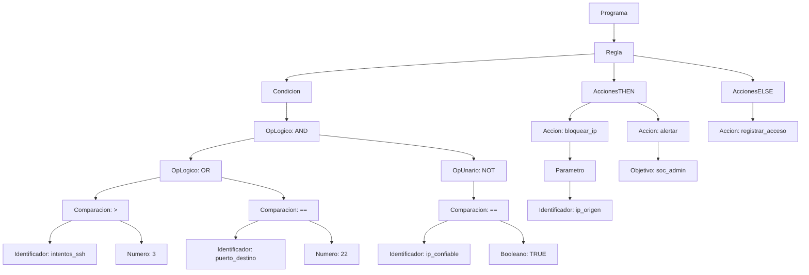

# TEORÍA DE LA COMPUTACIÓN – INFO1148
## Informe de Proyecto: Diseño e Implementación de un Analizador Sintáctico LL(1) para **CyberGuard DSL**

---

## 1. Introducción y Dominio Seleccionado

En la administración moderna de infraestructuras de red y Centros de Operaciones de Seguridad (*SOC*), los analistas necesitan definir políticas declarativas de respuesta ante incidentes (como ataques de fuerza bruta, escaneo de puertos, denegación de servicio DDoS o exfiltración de datos) sin la complejidad ni el riesgo de escribir scripts imperativos extensos.

### Dominio escogido: Reglas Simples de Ciberseguridad y Control de Firewall (**CyberGuard DSL**)
**CyberGuard DSL** es un Lenguaje de Dominio Específico (*DSL*) diseñado para especificar reglas automatizadas de detección y mitigación en un sistema de prevención de intrusiones (*IPS/Firewall*). Cada regla evalúa condiciones lógicas y relacionales sobre métricas de telemetría de red (intentos de autenticación, puertos de destino, volumen de tráfico, estado del firewall, listas blancas, etc.) y dispara una o más acciones defensivas (con o sin parámetros) tanto cuando la condición se cumple (`THEN`) como en su flujo alternativo (`ELSE`).

---

## 2. Especificación Formal del Lenguaje

### 2.1 Propósito del lenguaje
Permitir la escritura de programas formados por una o más reglas de seguridad con la estructura:
```text
WHEN <condicion_logica_relacional> THEN <lista_acciones> [ELSE <lista_acciones>] ;
```

### 2.2 Alfabeto relevante ($\Sigma$)
El alfabeto léxico del lenguaje está constituido por:
- **Letras ASCII:** `A-Z`, `a-z` y el guion bajo `_`.
- **Dígitos decimales:** `0-9`.
- **Símbolos relacionales:** `>`, `<`, `=`, `!`.
- **Símbolos de puntuación y agrupación:** `;`, `,`, `(`, `)`.
- **Delimitadores de comentarios y blancos:** espacio, tabulación (`\t`), salto de línea (`\n`), `#` y `//`.

### 2.3 Categorías de Tokens

| Categoría | Token | Expresión Regular / Lexemas | Descripción |
| :--- | :--- | :--- | :--- |
| **Palabras reservadas** (8) | `WHEN`, `THEN`, `ELSE`, `AND`, `OR`, `NOT`, `TRUE`, `FALSE` | `WHEN\|THEN\|ELSE\|AND\|OR\|NOT\|TRUE\|FALSE` (insensible a mayúsculas/minúsculas) | Palabras clave de control condicional, operadores booleanos y literales lógicos. |
| **Identificadores** | `ID` | `[A-Za-z_][A-Za-z0-9_]*` | Variables de telemetría (`intentos_ssh`, `puerto`, `ip_origen`) y nombres de acciones (`bloquear_ip`, `aislar_host`). |
| **Valores numéricos** | `NUM` | `\d+` | Literales enteros no negativos (`22`, `443`, `1000`, `5`). |
| **Valores booleanos** | `TRUE`, `FALSE` | `TRUE`, `FALSE` | Estados de verdad para banderas de seguridad. |
| **Operadores relacionales** (6) | `OP_REL` | `>=\|<=\|==\|!=\|>\|<` | Comparadores numéricos y de igualdad. |
| **Operadores lógicos** (3) | `AND`, `OR`, `NOT` | `AND`, `OR`, `NOT` | Conjunción, disyunción y negación lógica con jerarquía de precedencia. |
| **Separadores y agrupadores** | `PUNTO_COMA`, `COMA`, `PARENT_IZQ`, `PARENT_DER` | `;`, `,`, `(`, `)` | Fin de regla (`;`), separador de múltiples acciones (`,`) y agrupación/parámetros (`(`, `)`). |

### 2.4 Ejemplos de Sentencias Iniciales (5 Válidas y 5 Inválidas)

#### Cinco (5) sentencias sintácticamente válidas:
1. `WHEN intentos_login > 5 THEN bloquear ip_origen;`
2. `WHEN puerto_destino == 22 AND ip_verificada == FALSE THEN cerrar_puerto(22);`
3. `WHEN trafico_mb >= 1000 OR conexiones_activas >= 500 THEN limitar_ancho_banda(100), alertar soc_admin;`
4. `WHEN NOT firewall_activo == TRUE THEN activar firewall_perimetral, registrar_incidente;`
5. `WHEN (intentos_ssh > 3 OR intentos_rdp > 3) AND ip_interna == FALSE THEN aislar_host(ip_origen) ELSE registrar_acceso;`

#### Cinco (5) sentencias sintácticamente inválidas:
1. `intentos_login > 5 THEN bloquear ip_origen;` *(Omisión de la palabra reservada `WHEN` al inicio).*
2. `WHEN intentos_login > THEN bloquear ip_origen;` *(Falta el valor después del operador relacional `>`).*
3. `WHEN intentos_login > 5 bloquear ip_origen;` *(Omisión de la palabra reservada `THEN`).*
4. `WHEN (intentos_login > 5 AND puerto == 22 THEN bloquear ip_origen;` *(Paréntesis `(` sin cerrar).*
5. `WHEN intentos_login > 5 THEN bloquear ip_origen` *(Falta el punto y coma `;` al final de la regla).*

---

## 3. Gramática Libre de Contexto (GLC)

Sea la Gramática Libre de Contexto $G = (V_N, V_T, P, S)$ en su versión final **LL(1)**:

- **Símbolo inicial ($S$):** `<programa>`
- **Conjunto de No Terminales ($V_N$, 16 símbolos):**
  $$V_N = \{ \text{<programa>}, \text{<resto\_programa>}, \text{<regla>}, \text{<condicion>}, \text{<resto\_or>}, \text{<termino\_and>}, \text{<resto\_and>}, \text{<factor\_not>}, \text{<primario>}, \text{<comparacion>}, \text{<valor>}, \text{<lista\_acciones>}, \text{<resto\_acciones>}, \text{<accion>}, \text{<complemento\_accion>}, \text{<clausula\_else>} \}$$
- **Conjunto de Terminales ($V_T$, 15 símbolos):**
  $$V_T = \{ \texttt{WHEN}, \texttt{THEN}, \texttt{ELSE}, \texttt{AND}, \texttt{OR}, \texttt{NOT}, \texttt{TRUE}, \texttt{FALSE}, \texttt{ID}, \texttt{NUM}, \texttt{OP\_REL}, \texttt{PARENT\_IZQ}, \texttt{PARENT\_DER}, \texttt{COMA}, \texttt{PUNTO\_COMA} \}$$

### Conjunto de Producciones ($P$):
```text
(01) <programa>           -> <regla> <resto_programa>
(02) <resto_programa>     -> <regla> <resto_programa> | ε
(03) <regla>              -> WHEN <condicion> THEN <lista_acciones> <clausula_else> PUNTO_COMA
(04) <condicion>          -> <termino_and> <resto_or>
(05) <resto_or>           -> OR <termino_and> <resto_or> | ε
(06) <termino_and>        -> <factor_not> <resto_and>
(07) <resto_and>          -> AND <factor_not> <resto_and> | ε
(08) <factor_not>         -> NOT <factor_not> | <primario>
(09) <primario>           -> PARENT_IZQ <condicion> PARENT_DER | <comparacion>
(10) <comparacion>        -> ID OP_REL <valor>
(11) <valor>              -> NUM | TRUE | FALSE | ID
(12) <lista_acciones>     -> <accion> <resto_acciones>
(13) <resto_acciones>     -> COMA <accion> <resto_acciones> | ε
(14) <accion>             -> ID <complemento_accion>
(15) <complemento_accion> -> ID | PARENT_IZQ <valor> PARENT_DER | ε
(16) <clausula_else>      -> ELSE <lista_acciones> | ε
```

---

## 4. Análisis de la Gramática

### 4.1 Resolución de Ambigüedad
Una formulación inicial ingenua para las condiciones booleanas sería:
```text
<condicion> -> <condicion> OR <condicion>
             | <condicion> AND <condicion>
             | NOT <condicion>
             | ( <condicion> )
             | <comparacion>
```
Esta formulación es **ambigua** porque una sentencia como `a > 1 OR b < 2 AND c == 3` admite dos árboles de derivación distintos (uno agrupando `(a > 1 OR b < 2) AND c == 3` y otro `a > 1 OR (b < 2 AND c == 3)`).
**Solución aplicada:** Se estratificó la gramática por niveles de precedencia de menor a mayor prioridad:
1. Nivel 1 (menor precedencia): `<condicion>` maneja la disyunción `OR`.
2. Nivel 2: `<termino_and>` maneja la conjunción `AND`.
3. Nivel 3: `<factor_not>` maneja la negación unaria `NOT` (recursiva por la derecha, asociativa a la derecha).
4. Nivel 4 (mayor precedencia): `<primario>` maneja paréntesis `( <condicion> )` y comparaciones atómicas `<comparacion>`.

### 4.2 Análisis y Eliminación de Recursión por la Izquierda
Al estratificar por precedencia, las reglas asociativas por la izquierda presentarían recursión izquierda directa ($A \to A\alpha \mid \beta$):
- `<condicion> -> <condicion> OR <termino_and> | <termino_and>`
- `<termino_and> -> <termino_and> AND <factor_not> | <factor_not>`
- `<lista_acciones> -> <lista_acciones> COMA <accion> | <accion>`

Aplicando la transformación estándar ($A \to \beta A'$, $A' \to \alpha A' \mid \varepsilon$), se eliminó toda recursión izquierda obteniendo:
- `<condicion> -> <termino_and> <resto_or>` y `<resto_or> -> OR <termino_and> <resto_or> | ε`
- `<termino_and> -> <factor_not> <resto_and>` y `<resto_and> -> AND <factor_not> <resto_and> | ε`
- `<lista_acciones> -> <accion> <resto_acciones>` y `<resto_acciones> -> COMA <accion> <resto_acciones> | ε`

### 4.3 Análisis y Aplicación de Factorización por la Izquierda
Existían dos puntos con prefijos comunes ($A \to \alpha\beta_1 \mid \alpha\beta_2$) que habrían generado conflictos `FIRST/FIRST`:
1. **En `<programa>`:**
   - Antes: `<programa> -> <regla> <programa> | <regla>` (prefijo común `<regla>`).
   - Factorizado:
     ```text
     <programa>       -> <regla> <resto_programa>
     <resto_programa> -> <regla> <resto_programa> | ε
     ```
2. **En `<accion>`:**
   - Nuestro lenguaje permite tres formatos de acción: verbo-objeto (`bloquear ip_origen`), llamada con parámetro (`cerrar_puerto(22)`) y acción simple (`registrar_incidente`).
   - Antes: `<accion> -> ID ID | ID PARENT_IZQ <valor> PARENT_DER | ID` (prefijo común `ID`).
   - Factorizado:
     ```text
     <accion>             -> ID <complemento_accion>
     <complemento_accion> -> ID | PARENT_IZQ <valor> PARENT_DER | ε
     ```

---

## 5. Conjuntos FIRST y FOLLOW

Aplicando las reglas formales de punto fijo sobre la gramática factorizada y sin recursión izquierda:

| No Terminal ($A$) | $\text{FIRST}(A)$ | $\text{FOLLOW}(A)$ | Justificación resumida |
| :--- | :--- | :--- | :--- |
| `<programa>` | `{ WHEN }` | `{ $ }` | Inicia con `<regla>` (`WHEN`); es el símbolo inicial ($S$). |
| `<resto_programa>` | `{ WHEN, ε }` | `{ $ }` | Deriva `<regla>` o `ε`; al final de `<programa>` hereda `FOLLOW(<programa>)`. |
| `<regla>` | `{ WHEN }` | `{ WHEN, $ }` | Inicia con terminal `WHEN`; va seguido de `<resto_programa>` (`WHEN` o `$`). |
| `<condicion>` | `{ ID, NOT, PARENT_IZQ }` | `{ PARENT_DER, THEN }` | Hereda `FIRST(<termino_and>)`; aparece antes de `THEN` o de `)` en `<primario>`. |
| `<resto_or>` | `{ OR, ε }` | `{ PARENT_DER, THEN }` | Inicia con `OR` o `ε`; al final de `<condicion>` hereda su `FOLLOW`. |
| `<termino_and>` | `{ ID, NOT, PARENT_IZQ }` | `{ OR, PARENT_DER, THEN }` | Hereda `FIRST(<factor_not>)`; seguido por `<resto_or>` (`OR` o `FOLLOW(<condicion>)`). |
| `<resto_and>` | `{ AND, ε }` | `{ OR, PARENT_DER, THEN }` | Inicia con `AND` o `ε`; al final de `<termino_and>` hereda su `FOLLOW`. |
| `<factor_not>` | `{ ID, NOT, PARENT_IZQ }` | `{ AND, OR, PARENT_DER, THEN }` | Inicia con `NOT` o `FIRST(<primario>)`; seguido por `<resto_and>`. |
| `<primario>` | `{ ID, PARENT_IZQ }` | `{ AND, OR, PARENT_DER, THEN }` | Inicia con `(` o `FIRST(<comparacion>) = {ID}`. |
| `<comparacion>` | `{ ID }` | `{ AND, OR, PARENT_DER, THEN }` | Inicia obligatoriamente con `ID`. |
| `<valor>` | `{ FALSE, ID, NUM, TRUE }` | `{ AND, OR, PARENT_DER, THEN }` | Literales o `ID`; aparece al final de `<comparacion>` y antes de `)` en parámetros. |
| `<lista_acciones>` | `{ ID }` | `{ ELSE, PUNTO_COMA }` | Inicia con `<accion>` (`ID`); precede a `<clausula_else>` (`ELSE`) o `;`. |
| `<resto_acciones>` | `{ COMA, ε }` | `{ ELSE, PUNTO_COMA }` | Inicia con `,` o `ε`; al final de `<lista_acciones>` hereda su `FOLLOW`. |
| `<accion>` | `{ ID }` | `{ COMA, ELSE, PUNTO_COMA }` | Inicia con `ID`; seguido de `<resto_acciones>` (`,`, `ELSE`, `;`). |
| `<complemento_accion>` | `{ ID, PARENT_IZQ, ε }` | `{ COMA, ELSE, PUNTO_COMA }` | Inicia con `ID`, `(` o `ε`; al final de `<accion>` hereda su `FOLLOW`. |
| `<clausula_else>` | `{ ELSE, ε }` | `{ PUNTO_COMA }` | Inicia con `ELSE` o `ε`; precede inmediatamente a `PUNTO_COMA` (`;`). |

---

## 6. Tabla Predictiva LL(1)

A partir de los conjuntos `FIRST` y `FOLLOW`, se construye la matriz $M[A, a]$.
- **Total de entradas definidas:** 39 celdas activas.
- **Conflictos detectados:** **0** (ninguna celda posee más de una producción).
- **Conclusión formal:** La gramática cumple estrictamente la condición **LL(1)**:
  1. Para toda producción $A \to \alpha \mid \beta$, $\text{FIRST}(\alpha) \cap \text{FIRST}(\beta) = \emptyset$.
  2. Para todo no terminal anulable ($A \Rightarrow^* \varepsilon$), $\text{FIRST}(A) \cap \text{FOLLOW}(A) = \emptyset$.

### Entradas Activas de la Tabla Predictiva $M[\text{NoTerminal}, \text{Terminal}]$

| No Terminal | Terminal de Entrada ($a$) | Producción Aplicada ($A \to \alpha$) |
| :--- | :--- | :--- |
| `<programa>` | `WHEN` | `<programa> -> <regla> <resto_programa>` |
| `<resto_programa>` | `WHEN` | `<resto_programa> -> <regla> <resto_programa>` |
| `<resto_programa>` | `$` | `<resto_programa> -> ε` |
| `<regla>` | `WHEN` | `<regla> -> WHEN <condicion> THEN <lista_acciones> <clausula_else> PUNTO_COMA` |
| `<condicion>` | `ID`, `NOT`, `PARENT_IZQ` | `<condicion> -> <termino_and> <resto_or>` |
| `<resto_or>` | `OR` | `<resto_or> -> OR <termino_and> <resto_or>` |
| `<resto_or>` | `PARENT_DER`, `THEN` | `<resto_or> -> ε` |
| `<termino_and>` | `ID`, `NOT`, `PARENT_IZQ` | `<termino_and> -> <factor_not> <resto_and>` |
| `<resto_and>` | `AND` | `<resto_and> -> AND <factor_not> <resto_and>` |
| `<resto_and>` | `OR`, `PARENT_DER`, `THEN` | `<resto_and> -> ε` |
| `<factor_not>` | `NOT` | `<factor_not> -> NOT <factor_not>` |
| `<factor_not>` | `ID`, `PARENT_IZQ` | `<factor_not> -> <primario>` |
| `<primario>` | `PARENT_IZQ` | `<primario> -> PARENT_IZQ <condicion> PARENT_DER` |
| `<primario>` | `ID` | `<primario> -> <comparacion>` |
| `<comparacion>` | `ID` | `<comparacion> -> ID OP_REL <valor>` |
| `<valor>` | `NUM` | `<valor> -> NUM` |
| `<valor>` | `TRUE` | `<valor> -> TRUE` |
| `<valor>` | `FALSE` | `<valor> -> FALSE` |
| `<valor>` | `ID` | `<valor> -> ID` |
| `<lista_acciones>` | `ID` | `<lista_acciones> -> <accion> <resto_acciones>` |
| `<resto_acciones>` | `COMA` | `<resto_acciones> -> COMA <accion> <resto_acciones>` |
| `<resto_acciones>` | `ELSE`, `PUNTO_COMA` | `<resto_acciones> -> ε` |
| `<accion>` | `ID` | `<accion> -> ID <complemento_accion>` |
| `<complemento_accion>` | `ID` | `<complemento_accion> -> ID` |
| `<complemento_accion>` | `PARENT_IZQ` | `<complemento_accion> -> PARENT_IZQ <valor> PARENT_DER` |
| `<complemento_accion>` | `COMA`, `ELSE`, `PUNTO_COMA` | `<complemento_accion> -> ε` |
| `<clausula_else>` | `ELSE` | `<clausula_else> -> ELSE <lista_acciones>` |
| `<clausula_else>` | `PUNTO_COMA` | `<clausula_else> -> ε` |

---

## 7. Diseño e Implementación del Parser

El sistema se diseñó en Python siguiendo una arquitectura modular sin emplear generadores automáticos de parsers:

1. **`lexer.py`**: Implementa `tokenizar_detallado(cadena)` y `analizador_lexico(cadena)` utilizando expresiones regulares compiladas, reconociendo palabras reservadas, identificadores, operadores relacionales, números, paréntesis, comas y comentarios (`#` y `//`), almacenando fila, columna y posición de cada token.
2. **`grammar_ll1.py`**: Modela explícitamente `NO_TERMINALES`, `TERMINALES` y `PRODUCCIONES`, e implementa los algoritmos iterativos de punto fijo `calcular_first()`, `calcular_follow()` y `construir_tabla_ll1()`.
3. **`parser.py`**: Contiene dos implementaciones complementarias y coherentes entre sí:
   - `ParserDescensoRecursivo`: Un método por cada uno de los 16 no terminales (`parse_programa`, `parse_regla`, `parse_condicion`, etc.), que decide qué producción expandir consultando únicamente el token de preanálisis (`self.token_actual`, *lookahead* $k=1$) y construye simultáneamente el **Árbol Sintáctico Concreto** y el **AST**.
   - `ParserTablaLL1`: Analizador predictivo no recursivo basado en una pila explícita y la tabla $M[A, a]$.
4. **`ast_visualizer.py`**: Genera representaciones en texto jerárquico (`├──`, `└──`), código Graphviz (`.dot`), diagramas Mermaid y gráficos vectoriales `.svg`.
5. **`tests.py` y `main.py`**: Suite automatizada con 30 casos de prueba y CLI de demostración.

---

## 8. Árbol Sintáctico y Árbol de Sintaxis Abstracta (AST)

Para la sentencia válida representativa:
```text
WHEN (intentos_ssh > 3 OR puerto_destino == 22) AND NOT ip_confiable == TRUE
THEN bloquear_ip(ip_origen), alertar soc_admin ELSE registrar_acceso;
```

### 8.1 Representación Jerárquica del AST
```text
Programa
└── Regla
    ├── Condicion
    │   └── OpLogico: AND
    │       ├── OpLogico: OR
    │       │   ├── Comparacion: >
    │       │   │   ├── Identificador: intentos_ssh
    │       │   │   └── Numero: 3
    │       │   └── Comparacion: ==
    │       │       ├── Identificador: puerto_destino
    │       │       └── Numero: 22
    │       └── OpUnario: NOT
    │           └── Comparacion: ==
    │               ├── Identificador: ip_confiable
    │               └── Booleano: TRUE
    ├── AccionesTHEN
    │   ├── Accion: bloquear_ip
    │   │   └── Parametro
    │   │       └── Identificador: ip_origen
    │   └── Accion: alertar
    │       └── Objetivo: soc_admin
    └── AccionesELSE
        └── Accion: registrar_acceso
```

### 8.2 Diagrama Visual del AST (Mermaid)


*(Además, la ejecución de `python main.py` genera los archivos gráficos vectoriales `ast_ejemplo.svg`, `arbol_sintactico_ejemplo.svg`, `ast_ejemplo.dot` y `arbol_sintactico_ejemplo.dot` en el repositorio).*

---

## 9. Manejo de Errores Sintácticos

El analizador sintáctico y léxico reporta errores detallados indicando **qué se esperaba**, **qué símbolo se encontró** y la **posición exacta (número de token, línea y columna)**:

- **Falta de valor tras operador relacional:**
  > `Error sintáctico: se esperaba un valor (NUM, TRUE, FALSE o ID) después del operador >, pero se encontró 'THEN' [cerca de la posición 4 (línea 1, columna 23)].`
- **Omisión de la palabra reservada `THEN`:**
  > `Error sintáctico: se esperaba la palabra reservada THEN o un operador lógico (AND, OR) antes de 'bloquear' cerca de la posición 5 [cerca de la posición 5 (línea 1, columna 25)].`
- **Paréntesis desbalanceado:**
  > `Error sintáctico: se esperaba el paréntesis de cierre ')' para cerrar la agrupación [cerca de la posición 10 (línea 1, columna 43)].`
- **Omisión de punto y coma `;` al final de la regla:**
  > `Error sintáctico: se esperaba ';' al final de la regla antes de finalizar la entrada [al final de la entrada (posición 8, línea 1)].`

---

## 10. Casos de Prueba y Extensión Creativa

### 10.1 Extensiones Creativas Integradas
Se integraron **cuatro extensiones creativas** directamente en la gramática LL(1), en los conjuntos `FIRST`/`FOLLOW`, en la Tabla LL(1) y en el parser:
1. **Agrupación con paréntesis `( <condicion> )`** con anidamiento arbitrario.
2. **Operador lógico unario `NOT`** con precedencia formal superior a `AND` y `OR`.
3. **Estructura condicional `ELSE` opcional** (`WHEN ... THEN ... ELSE ... ;`).
4. **Múltiples acciones separadas por coma (`,`) y acciones con parámetros `accion(valor)`**.

### 10.2 Tabla de 30 Casos de Prueba (12 Válidas, 12 Inválidas y 6 Casos Límite)

| ID | Categoría | Entrada | Resultado Esperado | Resultado Obtenido | Observación / Mensaje del Analizador |
| :--- | :--- | :--- | :--- | :--- | :--- |
| **V01** | Válida | `WHEN intentos_login > 5 THEN bloquear ip_origen;` | Aceptada | Aceptada | Regla simple de fuerza bruta con operador `>` y acción verbo-objeto. |
| **V02** | Válida | `WHEN puerto_destino == 22 AND ip_verificada == FALSE THEN cerrar_puerto(22);` | Aceptada | Aceptada | Condición compuesta con `AND`, booleano `FALSE` y acción con parámetro numérico. |
| **V03** | Válida | `WHEN trafico_mb >= 1000 OR conexiones_activas >= 500 THEN limitar_ancho_banda(100), alertar soc_admin;` | Aceptada | Aceptada | Operador `OR` y múltiples acciones separadas por coma. |
| **V04** | Válida | `WHEN NOT firewall_activo == TRUE THEN activar firewall_perimetral, registrar_incidente;` | Aceptada | Aceptada | Uso del operador unario `NOT` y combinación de acción con objeto y acción simple. |
| **V05** | Válida | `WHEN (intentos_ssh > 3 OR intentos_rdp > 3) AND ip_interna == FALSE THEN aislar_host(ip_origen) ELSE registrar_acceso;` | Aceptada | Aceptada | Agrupación con paréntesis, precedencia `OR`/`AND` y cláusula `ELSE`. |
| **V06** | Válida | `WHEN nivel_amenaza != 0 THEN bloquear_ip(ip_atacante), cerrar_puerto(445), notificar_admin(TRUE);` | Aceptada | Aceptada | Tres acciones encadenadas con parámetros `ID`, `NUM` y `TRUE`. |
| **V07** | Válida | `WHEN paquetes_syn > 10000 AND NOT (ip_whitelist == TRUE OR modo_mantenimiento == TRUE) THEN activar_mitigacion_ddos;` | Aceptada | Aceptada | Negación `NOT` aplicada sobre una agrupación entre paréntesis. |
| **V08** | Válida | `WHEN latencia_ms <= 50 AND perdida_paquetes < 2 THEN mantener_ruta_principal ELSE conmutar_respaldo;` | Aceptada | Aceptada | Operadores relacionales `<=` y `<` con rama `ELSE`. |
| **V09** | Válida | `WHEN firma_malware == TRUE THEN poner_cuarentena archivo_sospechoso; WHEN riesgo_fuga >= 80 THEN bloquear_puerto(21);` | Aceptada | Aceptada | Programa compuesto por múltiples reglas consecutivas. |
| **V10** | Válida | `WHEN payload_sql == TRUE OR (cabecera_xss == TRUE AND waf_activo == FALSE) THEN rechazar_peticion, bloquear_ip(cliente_http);` | Aceptada | Aceptada | Expresión anidada en segundo operando de `OR` con acciones múltiples. |
| **V11** | Válida | `WHEN certificado_vencido == TRUE THEN redirigir_trafico(443) ELSE permitir_conexion(80);` | Aceptada | Aceptada | Acciones parametrizadas tanto en `THEN` como en `ELSE`. |
| **V12** | Válida | `WHEN temperatura > 28 AND humedad < 40 THEN encender ventilador;` | Aceptada | Aceptada | Compatibilidad con la sentencia de prueba del notebook base. |
| **I01** | Inválida | `intentos_login > 5 THEN bloquear ip_origen;` | Rechazada | Rechazada | `Error sintáctico: se esperaba la palabra reservada WHEN al inicio de la regla...` |
| **I02** | Inválida | `WHEN intentos_login > THEN bloquear ip_origen;` | Rechazada | Rechazada | `Error sintáctico: se esperaba un valor (NUM, TRUE, FALSE o ID) después del operador >...` |
| **I03** | Inválida | `WHEN intentos_login > 5 bloquear ip_origen;` | Rechazada | Rechazada | `Error sintáctico: se esperaba la palabra reservada THEN o un operador lógico (AND, OR)...` |
| **I04** | Inválida | `WHEN intentos_login > 5 THEN bloquear ip_origen` | Rechazada | Rechazada | `Error sintáctico: se esperaba ';' al final de la regla antes de finalizar la entrada...` |
| **I05** | Inválida | `WHEN intentos_login 5 THEN bloquear ip_origen;` | Rechazada | Rechazada | `Error sintáctico: se esperaba un operador relacional (>, <, >=, <=, ==, !=)...` |
| **I06** | Inválida | `WHEN (intentos_login > 5 AND puerto == 22 THEN bloquear ip_origen;` | Rechazada | Rechazada | `Error sintáctico: se esperaba el paréntesis de cierre ')' para cerrar la agrupación...` |
| **I07** | Inválida | `WHEN intentos_login > 5 AND THEN bloquear ip_origen;` | Rechazada | Rechazada | `Error sintáctico: se esperaba una condición (identificador, NOT o '(') después de 'AND'...` |
| **I08** | Inválida | `WHEN intentos_login > 5 THEN ;` | Rechazada | Rechazada | `Error sintáctico: se esperaba un identificador de acción después de 'THEN'...` |
| **I09** | Inválida | `WHEN intentos_login > 5 THEN bloquear_puerto();` | Rechazada | Rechazada | `Error sintáctico: se esperaba un parámetro dentro de 'bloquear_puerto(...)' antes de ')'...` |
| **I10** | Inválida | `WHEN intentos_login > 5 THEN bloquear ip_origen, ;` | Rechazada | Rechazada | `Error sintáctico: se esperaba un identificador de acción después de ','...` |
| **I11** | Inválida | `WHEN intentos_login > 5 THEN bloquear ip_origen ELSE ;` | Rechazada | Rechazada | `Error sintáctico: se esperaba un identificador de acción después de 'ELSE'...` |
| **I12** | Inválida | `WHEN intentos_login > 5 @ puerto == 22 THEN bloquear ip_origen;` | Rechazada | Rechazada | `Error léxico en línea 1, columna 25 (posición 5): símbolo no reconocido '@'.` |
| **L01** | Caso Límite | `""` *(cadena vacía)* | Rechazada | Rechazada | `Error sintáctico: la entrada está vacía; se esperaba al menos una regla iniciada con WHEN...` |
| **L02** | Caso Límite | `((WHEN ((puerto == 80)) THEN auditar));` | Rechazada | Rechazada | Los paréntesis solo agrupan condiciones, no la sentencia `WHEN` completa. |
| **L03** | Caso Límite | `WHEN (((NOT NOT alerta_critica == TRUE))) THEN aislar_nodo;` | Aceptada | Aceptada | Triple anidamiento de paréntesis y doble negación recursiva `NOT NOT`. |
| **L04** | Caso Límite | `when trafico_mb > 0 then registrar_log;` | Aceptada | Aceptada | Palabras reservadas en minúsculas reconocidas correctamente. |
| **L05** | Caso Límite | `# Comentario\nWHEN puerto == 443 THEN permitir_tls; // Fin` | Aceptada | Aceptada | Programa multilínea con comentarios `#` y `//` intercalados. |
| **L06** | Caso Límite | `WHEN a == b AND c != d AND e >= f OR g <= h THEN acc1, acc2(1), acc3 obj3, acc4(TRUE) ELSE acc5;` | Aceptada | Aceptada | Combinación máxima de todos los operadores, tipos de acciones y rama `ELSE`. |

---

## 11. Conclusiones

1. **Coherencia entre Teoría Formal e Implementación:** El diseño de **CyberGuard DSL** demostró cómo las propiedades algebraicas de una Gramática Libre de Contexto impactan directamente en la construcción de un analizador sintáctico determinista. La estratificación de niveles de precedencia (`OR` $\to$ `AND` $\to$ `NOT` $\to$ `()`), combinada con la eliminación de recursión izquierda y la factorización por la izquierda, permitió obtener una tabla predictiva **LL(1) con 0 conflictos**.
2. **Modularidad y Diagnóstico de Errores:** La separación entre tokenización con coordenadas (`lexer.py`), análisis formal (`grammar_ll1.py`), reconocimiento sintáctico (`parser.py`) y visualización (`ast_visualizer.py`) facilitó tanto la generación de árboles sintácticos y AST como la entrega de mensajes de error precisos y localizados.

---

## 12. Anexos

### Archivos del Proyecto y Estructura del Repositorio
- `src/lexer.py`: Analizador léxico con soporte de metadatos de posición y comentarios.
- `src/grammar_ll1.py`: Definición de la GLC, cálculo algorítmico de `FIRST`, `FOLLOW` y Tabla `LL(1)`.
- `src/parser.py`: Analizador sintáctico por Descenso Recursivo y por Tabla LL(1) con generación de AST.
- `src/ast_visualizer.py`: Exportador de árboles a texto jerárquico, Graphviz DOT, Mermaid y SVG.
- `tests/test_suite.py`: Ejecución automatizada de los 30 casos de prueba (100% de acierto).
- `main.py`: Script principal de demostración e interfaz de línea de comandos.
- `notebooks/anlizador_lexico1.ipynb`: Notebook interactivo con todas las fases ejecutadas.
- `outputs/ast_ejemplo.svg` y `outputs/arbol_sintactico_ejemplo.svg`: Visualizaciones gráficas vectoriales generadas por el sistema.
